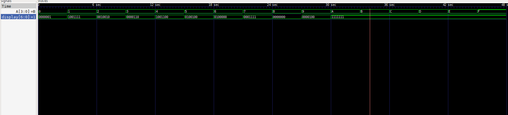
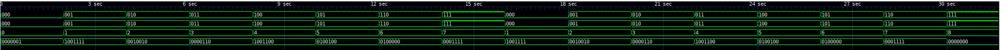
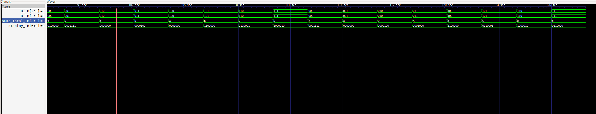
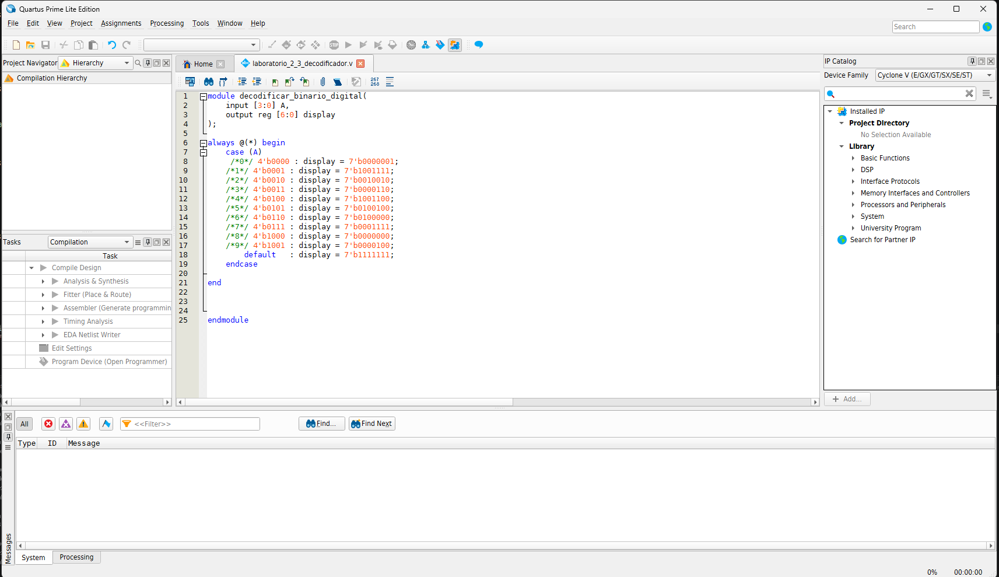
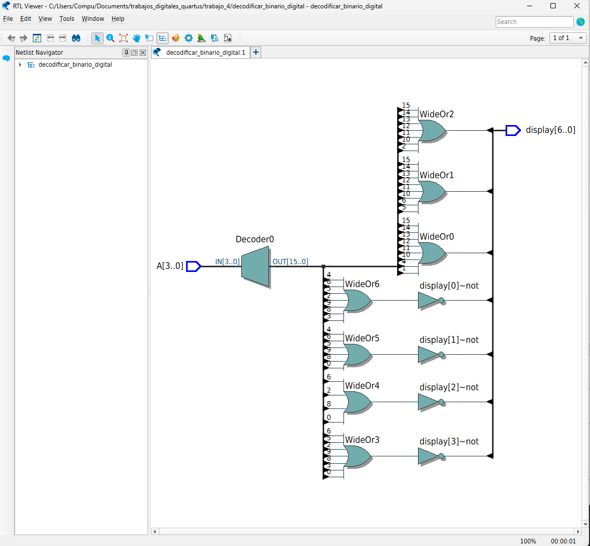
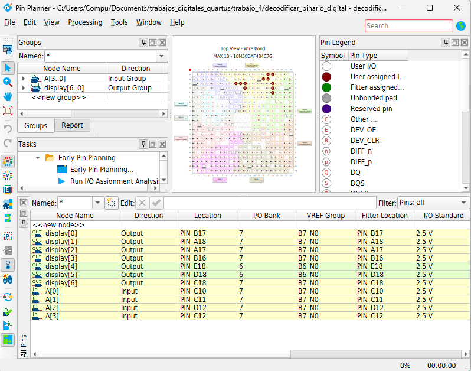
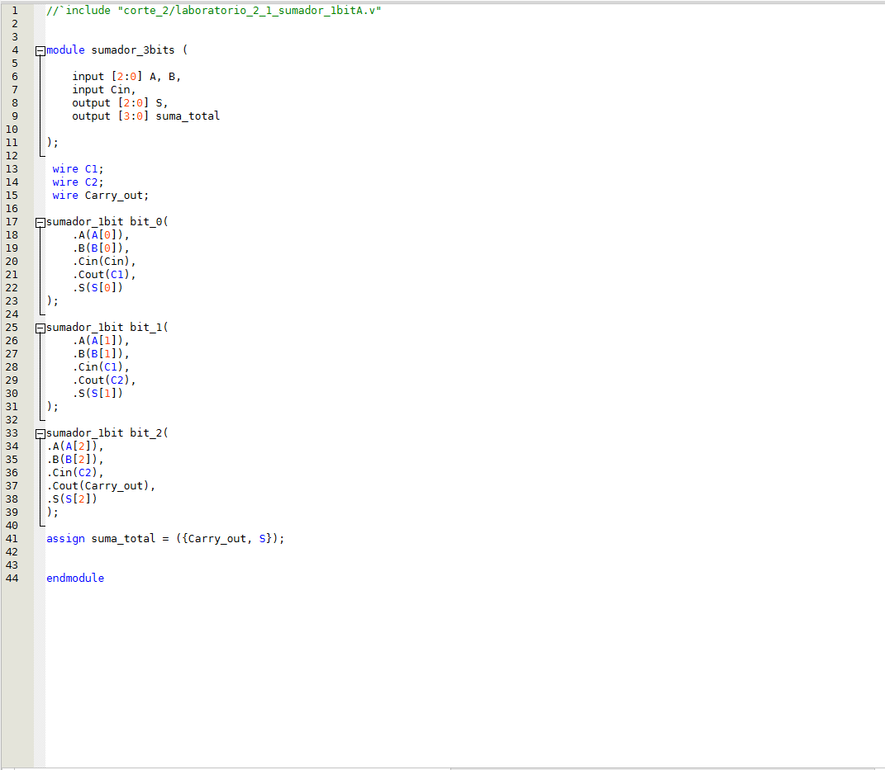
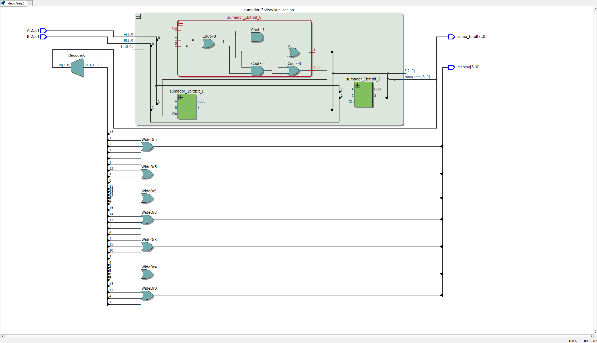
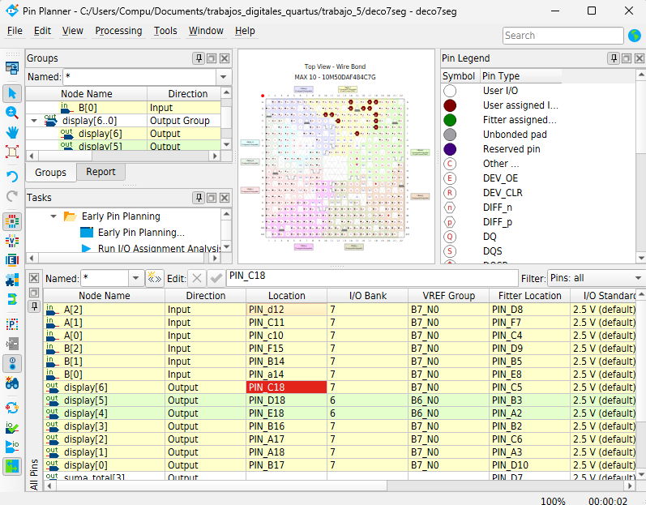

# Lab03 - Implementación de displays de siete segmentos

## Integrantes

- [Juan Carlos Ramos Arias](https://github.com/juancramosar-droid)
- Daniel Ducuara

## Informe

### Índice

1. [Documentación del diseño implementado](#documentacion-del-diseno-implementado)
2. [Simulaciones](#simulaciones)
3. [Evidencias de implementación](#evidencias-de-implementacion)
4. [Conclusiones](#conclusiones)
5. [Referencias](#referencias)

## 1. Documentación del diseño implementado

El objetivo del laboratorio fue utilizar los displays de siete segmentos de la tarjeta **DE10-Lite** para representar valores decimales y hexadecimales. El trabajo se dividió en dos partes:

1. Diseñar un decodificador de 4 bits que muestre los dígitos decimales de `0` a `9`.
2. Sumar dos números binarios de 3 bits y mostrar el resultado en formato hexadecimal.

Los códigos de salida utilizados son activos en bajo: un `0` enciende el segmento correspondiente y un `1` lo apaga.

### 1.1 Parte 1: decodificador decimal de 4 bits

El módulo `decodificar_binario_digital` recibe una entrada `A[3:0]` y produce el vector `display[6:0]`. Para las entradas comprendidas entre `0000` y `1001`, el bloque `case` genera el patrón necesario para representar los dígitos del 0 al 9. Las entradas de `1010` a `1111` no representan dígitos BCD válidos, por lo que el display se apaga mediante el patrón `1111111`.

Aunque el archivo de simulación se denomina `simulacion_BCD.vcd`, el circuito funciona como un decodificador decimal para entradas BCD válidas. Los valores de 10 a 15 no pertenecen al sistema BCD.

| Decimal | Entrada `A` | Salida `display` |
|:---:|:---:|:---:|
| 0 | `0000` | `0000001` |
| 1 | `0001` | `1001111` |
| 2 | `0010` | `0010010` |
| 3 | `0011` | `0000110` |
| 4 | `0100` | `1001100` |
| 5 | `0101` | `0100100` |
| 6 | `0110` | `0100000` |
| 7 | `0111` | `0001111` |
| 8 | `1000` | `0000000` |
| 9 | `1001` | `0000100` |
| 10–15 | `1010`–`1111` | `1111111` |

**Tabla 1.** Codificación decimal utilizada en la primera parte.

#### Código Verilog

Archivo: [`src/parte_1/laboratorio_2_3_decodificador.v`](src/parte_1/laboratorio_2_3_decodificador.v).

### 1.2 Parte 2: sumador de dos números de 3 bits

La segunda parte utiliza tres niveles jerárquicos:

1. `sumador_1bit`: suma dos bits y un acarreo de entrada.
2. `sumador_3bits`: instancia tres sumadores de 1 bit .
3. `deco7seg`: instancia el codigo de sumador de tres bits y convierte el resultado de 4 bits en un patrón hexadecimal para el display.

Las entradas `A[2:0]` y `B[2:0]` representan valores comprendidos entre 0 y 7. El acarreo inicial se fija en cero dentro del módulo superior, por lo que:

`suma_total = A + B`

El resultado mínimo es 0 y el máximo es 14, equivalente a `E` en hexadecimal. El decodificador también contiene el patrón de `F`, pero esa salida no se alcanza con dos operandos de 3 bits y `Cin = 0`.

| `A` | `B` | Resultado decimal | `suma_total` | Símbolo mostrado |
|:---:|:---:|:---:|:---:|:---:|
| `000` | `000` | 0 | `0000` | 0 |
| `001` | `001` | 2 | `0010` | 2 |
| `011` | `100` | 7 | `0111` | 7 |
| `111` | `001` | 8 | `1000` | 8 |
| `111` | `011` | 10 | `1010` | A |
| `111` | `111` | 14 | `1110` | E |

**Tabla 2.** Casos representativos del sumador de 3 bits.

#### Sumador completo de 1 bit

Archivo: [`src/parte_2/laboratorio_2_1_sumador_1bitA.v`](src/parte_2/laboratorio_2_1_sumador_1bitA.v).

#### Sumador de 3 bits

Archivo: [`src/parte_2/laboratorio_2_2_sumador_3bitB.v`](src/parte_2/laboratorio_2_2_sumador_3bitB.v).

#### Decodificador hexadecimal del resultado

Archivo: [`src/parte_2/deco7seg.v`](src/parte_2/deco7seg.v).

## 2. Simulaciones

Las simulaciones se realizaron con **Icarus Verilog** y se visualizaron mediante **GTKWave**. Los testbenches generaron archivos VCD para registrar las entradas y salidas de cada diseño.

### 2.1 Simulación del decodificador decimal

El testbench aplica las 16 combinaciones posibles de la entrada `A_TB`. Para los valores de 0 a 9 se espera el patrón del dígito correspondiente; para los valores de `A` a `F`, el patrón `1111111` apaga todos los segmentos.

Archivo: [`src/parte_1/laboratorio_2_3_decodificador_TB.v`](src/parte_1/laboratorio_2_3_decodificador_TB.v).

**Figura 1.** Formas de onda del decodificador decimal de 4 bits.

En la captura se observa que `display_TB` presenta los patrones correspondientes a los dígitos 0 a 9. Para las seis combinaciones restantes, la salida cambia a `1111111`, tal como establece el caso `default`.

### 2.2 Simulación del sumador de 3 bits y el decodificador hexadecimal

El testbench recorre todas las combinaciones de `A_TB` y `B_TB` mediante dos ciclos `for`. Como cada operando posee 3 bits, se prueban `8 × 8 = 64` combinaciones. La salida `suma_total_TB` contiene el resultado de 4 bits y `display_TB` contiene el patrón activo en bajo.

Archivo: [`src/parte_2/deco7seg_TB.v`](src/parte_2/deco7seg_TB.v).

**Figura 2.** Primer intervalo de la simulación del sumador y el decodificador hexadecimal.

**Figura 3.** Formas de onda que incluyen resultados comprendidos entre 6 y E.

Las capturas muestran la variación de los operandos, el resultado `suma_total_TB` y el patrón `display_TB`. Los resultados mayores que 9 se representan mediante los símbolos hexadecimales `A`, `B`, `C`, `D` y `E`.

## 3. Evidencias de implementación

### 3.1 Parte 1: decodificador decimal

El módulo fue ingresado en **Quartus Prime** y sintetizado como un circuito combinacional.

**Figura 4.** Código del decodificador decimal abierto en Quartus Prime.

La vista RTL muestra un decodificador de 4 a 16 líneas y la lógica combinacional necesaria para formar las siete salidas.

**Figura 5.** Estructura RTL generada para el decodificador decimal.

#### Asignación de pines

| Señal | Dirección | Pin asignado | Estándar de E/S |
|:---:|:---:|:---:|:---:|
| `A[0]` | Entrada | `PIN_C10` | 2.5 V |
| `A[1]` | Entrada | `PIN_C11` | 2.5 V |
| `A[2]` | Entrada | `PIN_D12` | 2.5 V |
| `A[3]` | Entrada | `PIN_C12` | 2.5 V |
| `display[0]` | Salida | `PIN_B17` | 2.5 V |
| `display[1]` | Salida | `PIN_A18` | 2.5 V |
| `display[2]` | Salida | `PIN_A17` | 2.5 V |
| `display[3]` | Salida | `PIN_B16` | 2.5 V |
| `display[4]` | Salida | `PIN_E18` | 2.5 V |
| `display[5]` | Salida | `PIN_D18` | 2.5 V |
| `display[6]` | Salida | `PIN_C18` | 2.5 V |

**Tabla 3.** Asignación de pines del decodificador decimal.

**Figura 6.** Asignaciones de la primera parte en Pin Planner.

En esta captura, las columnas **Location** y **Fitter Location** coinciden para todas las señales visibles.

#### Video de la parte 1

Los videos de funcionamiento del decodificador decimal deben almacenarse en [`videos/parte_1/`](videos/parte_1/).

### 3.2 Parte 2: sumador y decodificador hexadecimal

La captura del archivo `sumador_3bits` muestra la conexión en cascada de los tres módulos de 1 bit.

**Figura 7.** Código estructural del sumador de 3 bits.

La vista RTL permite identificar los tres sumadores, la propagación del acarreo y la lógica de decodificación del resultado.

**Figura 8.** Estructura RTL del sumador de 3 bits conectado al display.

#### Asignaciones solicitadas en Pin Planner

| Señal | Dirección | `Location` solicitada | Estándar de E/S |
|:---:|:---:|:---:|:---:|
| `A[0]` | Entrada | `PIN_C10` | 2.5 V (default) |
| `A[1]` | Entrada | `PIN_C11` | 2.5 V (default) |
| `A[2]` | Entrada | `PIN_D12` | 2.5 V (default) |
| `B[0]` | Entrada | `PIN_A14` | 2.5 V (default) |
| `B[1]` | Entrada | `PIN_B14` | 2.5 V (default) |
| `B[2]` | Entrada | `PIN_F15` | 2.5 V (default) |
| `display[0]` | Salida | `PIN_B17` | 2.5 V (default) |
| `display[1]` | Salida | `PIN_A18` | 2.5 V (default) |
| `display[2]` | Salida | `PIN_A17` | 2.5 V (default) |
| `display[3]` | Salida | `PIN_B16` | 2.5 V (default) |
| `display[4]` | Salida | `PIN_E18` | 2.5 V (default) |
| `display[5]` | Salida | `PIN_D18` | 2.5 V (default) |
| `display[6]` | Salida | `PIN_C18` | 2.5 V (default) |

**Tabla 4.** Asignaciones solicitadas para las señales visibles de la segunda parte.

**Figura 9.** Captura de Pin Planner de la segunda parte.

#### Video de la parte 2

Los videos de funcionamiento del sumador y del decodificador hexadecimal deben almacenarse en [`videos/parte_2/`](videos/parte_2/).

## 4. Conclusiones

1. El decodificador decimal permitió relacionar una entrada de 4 bits con los patrones activos en bajo requeridos por el display de siete segmentos.

2. El uso de un caso `default` permitió apagar el display para las seis combinaciones que no corresponden a dígitos BCD válidos.

3. El sumador de 3 bits se construyó jerárquicamente a partir de tres sumadores completos de 1 bit, permitiendo observar la propagación del acarreo entre etapas.

4. La integración del sumador con el decodificador hexadecimal permitió representar resultados de 0 a E. El símbolo F está definido en el código, pero no puede producirse al sumar dos operandos de 3 bits con acarreo inicial igual a cero.

5. Los testbenches verificaron las 16 entradas del decodificador decimal y las 64 combinaciones posibles de los dos operandos del sumador.

6. Las vistas RTL permitieron comprobar la estructura combinacional generada por Quartus Prime y la jerarquía formada por el sumador y el decodificador.

7. La asignación de pines de la primera parte presenta coincidencia entre las ubicaciones solicitadas y las utilizadas por el *fitter*. En la segunda parte todavía debe resolverse la diferencia visible entre ambas columnas antes de considerar validada la implementación física.

8. Para completar la evidencia experimental sería conveniente añadir fotografías de los displays de la DE10-Lite mostrando al menos un resultado decimal y un resultado hexadecimal.

## 5. Referencias

- ECCI. [Lab 03: Implementación de 7 segmentos](https://github.com/digital-ECCI/tecnicas-digitales-ECCI-2026-II/blob/main/labs/03_lab03/README.md).
- Intel. [Quartus Prime Design Software](https://www.intel.com/content/www/us/en/products/details/fpga/development-tools/quartus-prime/resource.html).
- Terasic. [DE10-Lite Development and Education Board: documentos y manual del usuario](https://www.terasic.com.tw/cgi-bin/page/archive.pl?CategoryNo=205&Language=English&No=1021&PartNo=4).
- Williams, S. [Documentación de Icarus Verilog](https://steveicarus.github.io/iverilog/).
- GTKWave. [Sitio y documentación oficial](https://gtkwave.sourceforge.net/).
